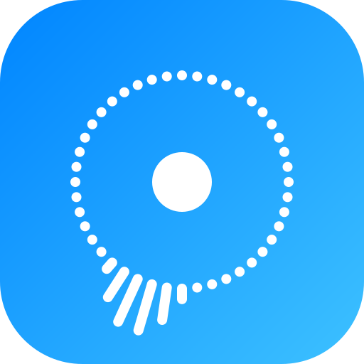

<p align="center"></p>

<h1 align="center">TuneGrab</h1>

Self-hosted web app that finds albums and songs on YouTube Music, downloads the **official audio** (not the music videos), tags it properly and files it into your music library for Navidrome, Jellyfin or anything else that reads folders of tagged files.

```
Imagine Dragons/
  LOOM/
    cover.jpg
    01 - Wake Up.mp3          title, artists, album, track number, year,
    02 - Nice to Meet You.mp3 cover art and synced lyrics embedded
```

## Overview

TuneGrab is the "get music" half of a home music setup. It drops tagged songs into a folder, and your music server plays them from that same folder.

```
YouTube Music  →  TuneGrab  →  your music folder  ←  Navidrome (or Jellyfin, Plex…)  →  your phone / browser
```

**You need:**
1. **A Linux machine with Docker** (with the Compose plugin): a home server, NAS or mini PC.
2. **A music folder** on that machine, e.g. `/srv/media/music`. It can be empty or already hold music.
3. **Optional: Navidrome**, pointed at that same music folder, with an admin account TuneGrab can sign in with. See below for what it adds.

### Navidrome is optional, but unlocks more

TuneGrab works on its own: it downloads music into your folder, and any player that reads that folder (Navidrome, Jellyfin, Plex, Kodi, a USB stick…) will pick it up. Connecting [Navidrome](https://www.navidrome.org) adds the features that need to know what you listen to:

| | Without Navidrome | With Navidrome |
|---|:---:|:---:|
| Search and download albums, songs and links | ✓ | ✓ |
| Tags, cover art and synced lyrics | ✓ | ✓ |
| Library tools: replace audio, lyrics, offload, delete | ✓ | ✓ |
| New downloads show up in your player right away | your player's next scan | ✓ (rescan after each download) |
| **Discover**: daily suggestions from what you play | | ✓ |
| **Playlists**: Daily Mix, Heavy Rotation, Rediscover and more | | ✓ |
| **Cleanup**: songs you keep skipping or never play | | ✓ |

To connect it, fill in the three `NAVIDROME_` settings below. You can add them any time later.

**Settings** all go in one file (`.env`). Only the first is required; with Navidrome it's usually 4, and 7 at most:

| Setting | What to put | |
|---|---|---|
| `MUSIC_PATH` | Your music folder, e.g. `/srv/media/music` | **required** |
| `PUID` / `PGID` | The user and group that own the music folder (`ls -ln` shows the numbers; usually `1000`) | if not 1000 |
| `NAVIDROME_URL` | Where Navidrome runs; on the same machine: `http://host.docker.internal:4533` | optional, for Navidrome |
| `NAVIDROME_USER` / `NAVIDROME_PASSWORD` | A Navidrome admin login | optional, for Navidrome |
| `TZ` | Your time zone, e.g. `America/New_York` | optional |

Everything else has sensible defaults, and the everyday options (how many songs are suggested, audio format, clean-only, which versions to hide…) can be changed on the **Settings** page in the app ([full list below](#settings)).

## Quick start

```bash
git clone https://github.com/LoganHoney/TuneGrab.git
cd TuneGrab
cp .env.example .env
nano .env                      # fill in the settings above
docker compose up -d --build
```

Open **http://your-server:8095**, search for an album and press Download. The first start takes a few minutes while the image builds.

If you add or change Navidrome settings later, run `docker compose up -d` to apply them. The Playlists page shows whether TuneGrab can reach Navidrome.

### Update

```bash
git pull && docker compose up -d --build
```

### Add it to your phone's home screen

TuneGrab works like an app on your phone: it gets the TuneGrab icon and opens full screen, without the browser's address bar.

**iPhone / iPad (Safari)**
1. Open TuneGrab in **Safari** (e.g. `http://your-server:8095`).
2. Tap the **Share** button (the square with an arrow pointing up).
3. Scroll down and tap **Add to Home Screen**, then **Add**.

**Android (Chrome)**
1. Open TuneGrab in **Chrome**.
2. Tap the **⋮** menu, then **Add to Home screen** (or **Install app**).

If you added TuneGrab before the icon existed, delete the old shortcut and add it again. Phones save the icon when the shortcut is created and don't update it afterwards.

## Features

**Search & download**
- One search box: type an artist, album or song, or paste YouTube / YouTube Music links to download them directly.
- Songs you already have are marked **in library**, and on albums they start unticked, so nothing is downloaded twice.
- **Hide versions you don't want** (live, remix, acoustic, instrumental, karaoke, sped up, covers) and turn on **clean only** to skip explicit songs.
- **Albums**: search, untick the tracks you don't want, Download. Tracks that YouTube Music links to a music video are swapped for the official audio of the same song (or the artist's own lyric video), so you don't get video intros and outros.
- **Songs**: a single track still lands in its real album with the right track number.
- **Paste URLs**: YouTube Music album links become full albums; other links go to `Artist/Singles`.
- Anything already downloaded is skipped.

**Library**: sort by artist, album, title or recently added; tap a song (or its ⋯ button) for its options.
- **Replace** a song's audio with a better version; tags, lyrics and the file name stay, so play counts and playlist spots survive. **Undo** for 14 days.
- **Offload** moves a song out of the library to `OFFLOAD_PATH` (nothing deleted); **Restore** brings it back.
- **Delete** (asks you to type `delete`).
- **Lyrics** are embedded on download: time-synced from LRCLIB where available, then YouTube Music. **Find missing lyrics** fills in older files, and **Earlier / Later 0.5s** fixes synced lyrics that are out of step.

**With Navidrome connected** (optional)
- **Discover**: daily suggestions from YouTube Music radio on your most-played and starred songs. Explicit songs are never suggested or downloaded. The top few are added automatically (`AUTO_ADD_SUGGESTIONS`, 0 to turn off).
- **Playlists**, rebuilt every few hours and shared with every Navidrome account: Daily Mix, Heavy Rotation, Rediscover, Fresh Additions, Never Played and Discoveries.
- **Cleanup**: songs you keep skipping and songs you never play, with **Keep** or **Offload**. Nothing moves on its own.

## Settings

The ones marked ⚙ can also be changed on the **Settings** page in the app (☰ → Settings); a change made there wins over `.env`. Everything else goes in `.env`, and `docker compose up -d` applies changes.

| Variable | Default | |
|---|---|---|
| `MUSIC_PATH` | | **Required.** Music folder on the host |
| `PUID` / `PGID` | `1000` | Owner of the music folder |
| `PORT` | `8095` | Web UI port |
| `TZ` | `Etc/UTC` | e.g. `America/New_York` |
| `NAVIDROME_URL` / `_USER` / `_PASSWORD` | | Navidrome login (an admin account) |
| `JELLYFIN_URL` / `JELLYFIN_API_KEY` | | Rescan Jellyfin after downloads |
| ⚙ `AUDIO_FORMAT` | `mp3` | `mp3`, `m4a` or `opus`. YouTube's source is Opus/AAC, so `opus`/`m4a` avoid a second lossy conversion; mp3 plays everywhere |
| `AUDIO_QUALITY` | `0` | mp3 only: `0` = best VBR, or a bitrate like `320` |
| `SLEEP_MIN` / `SLEEP_MAX` | `5` / `15` | Random pause between tracks so YouTube doesn't rate-limit you |
| `YTDLP_AUTO_UPDATE` | `true` | Update yt-dlp on each start. YouTube changes often; leave this on |
| ⚙ `LYRICS_AUTO` | `true` | Embed lyrics on download |
| `OFFLOAD_PATH` | `./offload` | Where **Offload** moves songs |
| `REPLACED_KEEP_DAYS` | `14` | How long replaced audio is kept for Undo |
| ⚙ `AUTO_ADD_SUGGESTIONS` | `3` | Suggestions downloaded automatically per refresh |
| ⚙ `MAX_SUGGESTIONS` | `25` | Suggestions per refresh |
| ⚙ `CLEAN_ONLY` | `false` | Never show or download explicit songs |
| ⚙ `HIDE_VERSIONS` | | Comma list of `live`, `remix`, `acoustic`, `instrumental`, `karaoke`, `sped up / slowed`, `cover` |
| `SUGGEST_REFRESH_HOURS` | `24` | `0` = only when you press the button |
| `PLAYLIST_REFRESH_HOURS` | `6` | Playlist rebuild and Cleanup review |
| `PLAYLIST_PREFIX` | `TuneGrab: ` | |
| ⚙ `PLAYLIST_SIZE` | `50` | Songs per playlist |
| `SKIP_LOG` | `true` | Watch Navidrome's now-playing to catch skips |
| `NOWPLAYING_POLL_SECONDS` | `10` | |
| `SKIP_MIN` / `SKIP_RATIO` / `SKIP_WINDOW_DAYS` | `3` / `0.6` / `90` | When a song counts as skipped often |
| `RARELY_PLAYED_DAYS` | `60` | |
| `SINGLES_ALBUM_NAME` | `Singles` | Album folder for loose videos |

## Troubleshooting

- **"Sign in to confirm you're not a bot"**: YouTube is throttling your IP. In **Settings**, upload a `cookies.txt` exported from a browser signed in to a spare Google account (automated use can get an account flagged), then **Retry failed**.
- **Downloads suddenly fail**: `docker compose restart tunegrab` pulls the newest yt-dlp.
- **Permission denied**: `PUID`/`PGID` don't own `MUSIC_PATH`. The logs name the folder: `docker logs tunegrab`.
- **Playlists or suggestions missing**: check the Playlists tab, which shows whether Navidrome is reachable.

## Using Dockge

Clone the repo into your stacks folder (`git clone https://github.com/LoganHoney/TuneGrab.git /opt/stacks/tunegrab`), create `.env` there, and start the stack from Dockge. Dockge's **Update** button only pulls images, so to update run `git pull && docker compose up -d --build` in that folder (or switch `compose.yaml` to the prebuilt `image:` line, which the included GitHub workflow publishes, and use **Update**).

## Security

There's no login. Keep it on your home network or behind a VPN such as Tailscale, or a reverse proxy with authentication. Don't port-forward it to the internet.

## Legal

yt-dlp is legal, but downloading copyrighted music from YouTube breaks YouTube's Terms of Service and is generally infringement unless you have the rights to it (music you've bought, Creative Commons or public-domain recordings, your own uploads). You're responsible for what you download.

## Licence

MIT, see [LICENSE](LICENSE). The licence covers TuneGrab's code; it doesn't give anyone rights to the music it downloads.
